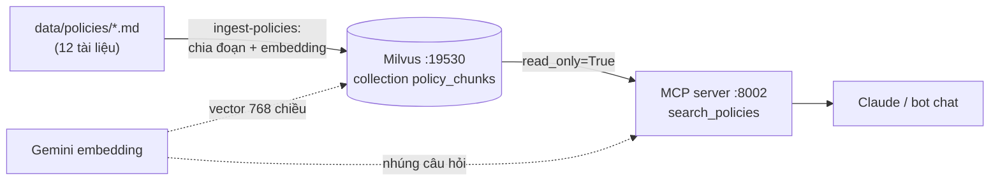

# Hỏi đáp chính sách (RAG)

Ngoài số liệu báo giá trong Postgres, repo có một kho **tài liệu chính sách** (quy trình thi công, định mức, bảo hành,
nghiệm thu) để agent trả lời các câu hỏi *"vì sao"* mà bảng số không nói được, ví dụ *"vì sao hai báo giá ghi thời
hạn bảo hành khác nhau?"*. Tài liệu được cắt thành đoạn, nhúng thành vector bằng Gemini, lưu trong Milvus và truy xuất qua
tool MCP `search_policies`. Toàn bộ nội dung là **giả lập** (công ty "Sơn Việt Demo Co.", xem phần miễn trừ trong README).

Tính năng này **tuỳ chọn**: không bật profile `rag` thì mọi thứ khác vẫn chạy như cũ, và `search_policies` trả lỗi rõ ràng
(`{"error": "..."}`) thay vì làm hỏng phiên MCP.

## Kiến trúc và luồng dữ liệu



- **Nạp (ghi):** `python -m app.cli ingest-policies data/policies --prune` (trong compose là service `policy-seed`). Mỗi tài liệu được
  cắt đoạn, nhúng bằng Gemini rồi ghi vào Milvus. Chạy lại an toàn: tài liệu không đổi (cùng nội dung và cùng model embedding) thì bỏ qua,
  không gọi Gemini. `--prune` xoá khỏi kho những tài liệu không còn trong thư mục. Mã thoát: 0 thành công, 1 có tài liệu lỗi, 2 sai đối số
  hoặc thiếu cấu hình (thiếu khoá, Milvus không kết nối được).
- **Truy xuất (đọc):** tool `search_policies(query, top_k=5, doc_type=None)` nhúng câu hỏi bằng cùng model rồi tìm các đoạn gần nhất
  (COSINE, chỉ trong các dòng cùng model). Kết quả: `{"passages": [{"slug", "title", "doc_type", "section", "text", "score"}], "row_count": n}`,
  xếp theo `score` giảm dần. `passages` rỗng nghĩa là không có quy định phù hợp. Bot chat được hướng dẫn chỉ dựa vào `text` và trích nguồn dạng `[slug › section]`.
- **Cắt đoạn:** theo heading. Văn bản được tách theo `##`/`###`; mỗi đoạn thuộc đúng một mục, dài tối đa 1000 ký tự, không chồng lấn.
  Mỗi đoạn được nhúng cùng đường dẫn mục (`tiêu đề › mục`) để câu hỏi ngắn vẫn khớp đúng ngữ cảnh. 12 tài liệu hiện cho 68 đoạn.

## Bộ tài liệu mẫu (`data/policies/`)

| `doc_type` | Tài liệu (`slug`) |
|---|---|
| `technical` | `xu-ly-be-mat`, `thi-cong-son-nuoc-va-ba-matit`, `thi-cong-chong-tham`, `thi-cong-epoxy-va-hieu-ung-da`, `thi-cong-kim-loai-va-chong-nong`, `dinh-muc-hao-hut-va-so-lop`, `dinh-muc-nhan-cong-va-to-doi`, `dieu-kien-thi-cong-va-an-toan` |
| `warranty` | `chinh-sach-bao-hanh`, `loai-tru-bao-hanh`, `quy-trinh-xu-ly-khieu-nai-bao-hanh`, `quy-trinh-nghiem-thu` |

Lưu ý về ngữ nghĩa: trong `chinh-sach-bao-hanh`, `extend_percent` (tỉ lệ phần trăm trên giá trị hợp đồng trả thêm) và `extend_period`
(số tháng bảo hành mua thêm) là **quy ước của bản demo**, vì mô tả cột trong dữ liệu không nói rõ; đừng xem đó là quy tắc nghiệp vụ thật.

## Chạy

Cần khoá Gemini (lấy tại https://aistudio.google.com/apikey) vì cả hai bước đều tạo embedding:

```bash
export GEMINI_API_KEY=...        # hoặc ghi vào file .env cạnh docker-compose.yml
docker compose --profile rag up -d                      # db + seed + api + mcp + milvus + policy-seed
docker compose --profile rag --profile chat up -d       # thêm API chat (cổng 8003)
docker compose --profile rag logs policy-seed           # xem kết quả nạp: mỗi tài liệu created/updated/unchanged
```

- `milvus` (image `milvusdb/milvus`, ghim phiên bản trong `docker-compose.yml`) chạy một container: etcd nhúng và lưu trữ cục bộ, dữ liệu trong volume
  **`milvus_data`**. `policy-seed` chờ Milvus khoẻ rồi nạp và thoát. `mcp` **không** chờ `policy-seed`: nó khởi động độc lập (RAG tuỳ chọn và cô lập), nên trong lúc chưa nạp xong, hoặc khi nạp lỗi, chỉ `search_policies` báo lỗi còn mọi tool khác vẫn chạy.
- **`docker compose down -v` xoá volume `milvus_data`**: kho chính sách mất hết. Lần `up` sau `policy-seed` nạp lại (tốn lượt gọi Gemini). `down` không kèm `-v` giữ nguyên dữ liệu.
- **Khoá Gemini cần ở cả `policy-seed` (nhúng tài liệu) lẫn `mcp` (nhúng câu hỏi lúc truy vấn).** Thiếu khoá thì `policy-seed` thoát mã 2 và
  `search_policies` trả `{"error": "Chưa cấu hình khoá Gemini ..."}`; `mcp` vẫn chạy và các tool khác không bị ảnh hưởng. Chưa nạp hoặc Milvus chưa chạy thì tool báo "Kho chính sách chưa được nạp hoặc không kết nối được".
- Ngoài compose: `docker compose --profile rag up -d milvus`, rồi `MILVUS_URI=http://127.0.0.1:19530 GEMINI_API_KEY=... python -m app.cli ingest-policies data/policies --prune`
  và chạy MCP với cùng hai biến. Biến cấu hình xem `.env.example`. `MILVUS_URI` kiểu host (`127.0.0.1`) chỉ dành cho chạy ngoài compose; các service trong compose luôn dùng `http://milvus:19530`.

### Khi `policy-seed` lỗi

`policy-seed` thoát mã khác 0 khi thiếu `GEMINI_API_KEY` hoặc Milvus không kết nối được (mã 2), hoặc có tài liệu lỗi (mã 1). Việc này **không** làm `mcp` dừng: `search_policies` trả
lỗi tiếng Việt ("Kho chính sách chưa được nạp ..." hoặc "Chưa cấu hình khoá Gemini ...") cho tới khi nạp thành công. Xem nguyên nhân: `docker compose --profile rag logs policy-seed`.
Khắc phục: sửa nguyên nhân (ví dụ đặt `GEMINI_API_KEY` trong `.env`, sửa file chính sách sai), rồi chạy lại bước nạp bằng `docker compose --profile rag up policy-seed`
(hoặc `docker compose --profile rag run --rm policy-seed`). Nếu đổi khoá, tạo lại cả `mcp` để nhận biến mới: `docker compose --profile rag up -d mcp`.

## Cấu hình

| Biến | Mặc định | Áp dụng | Ý nghĩa |
|---|---|---|---|
| `MILVUS_URI` | `http://127.0.0.1:19530` | chỉ host | máy chủ Milvus (hoặc đường dẫn file `.db` cho Milvus Lite). Compose **cố định** `http://milvus:19530` cho `mcp` và `policy-seed`, không đọc biến này |
| `MILVUS_TOKEN` | rỗng | chỉ host | token nếu Milvus bật xác thực (demo không bật; compose cố ý không chuyển biến này vào container) |
| `MILVUS_COLLECTION` | `policy_chunks` | compose và host | tên collection; compose chuyển cho cả `policy-seed` và `mcp`, hai nơi phải trùng |
| `GEMINI_EMBEDDING_MODEL` | `gemini-embedding-001` | compose và host | model embedding (vector 768 chiều); `policy-seed` và `mcp` phải trùng |
| `POLICY_MIN_SCORE` | `0.65` | compose (chỉ `mcp`) và host | đoạn có `score` thấp hơn bị bỏ khỏi kết quả; `0.0` là không lọc; hợp lệ trong [-1, 1]; `0.65` được đo trên `gemini-embedding-001` (xem "Đánh giá truy xuất") |

- **Vector gắn với model.** Mỗi dòng lưu tên model đã nhúng và truy vấn chỉ tìm trong các dòng cùng model với embedder đang dùng. Đổi `GEMINI_EMBEDDING_MODEL`
  thì phải chạy lại `ingest-policies` (với compose: `docker compose --profile rag up policy-seed`), và đặt cùng giá trị cho `mcp`. Nếu quên, truy vấn không có hit nào
  cho model hiện tại trong khi kho còn dòng của model khác, và `search_policies` trả `{"error": "Kho chính sách được nạp bằng model embedding khác ..."}` (không nêu tên model) thay vì `passages` rỗng; kho trống hoặc không có đoạn nào đủ điểm vẫn trả `passages` rỗng, không lỗi.
- **`POLICY_MIN_SCORE` = 0,65 là ngưỡng bảo thủ, đo ngày 2026-11-06 trên `gemini-embedding-001` (768 chiều).** Với 28 câu đánh giá, ngưỡng này không cắt câu trong phạm vi
  nào nhưng cũng chỉ chặn được khoảng một nửa câu ngoài phạm vi (câu gần chủ đề, ví dụ hỏi giá thùng sơn trên thị trường, vẫn lọt qua). Phần còn lại dựa vào chỉ dẫn của bot
  ("kết quả không liên quan thì nói chưa tìm thấy"). Số liệu và giới hạn của phép đo ở mục "Đánh giá truy xuất". Đổi model embedding thì phải đo lại, vì thang điểm khác nhau.

## Thêm một tài liệu chính sách

1. Tạo `data/policies/ten-tai-lieu.md` bắt đầu bằng front matter YAML:

   ```yaml
   ---
   slug: ten-tai-lieu          # duy nhất, chữ thường/số/gạch ngang, nên trùng tên file
   title: Tiêu đề hiển thị trong trích dẫn
   doc_type: technical         # technical (quy trình, định mức, điều kiện thi công) hoặc warranty (bảo hành, nghiệm thu)
   applies_to:                 # nhóm hạng mục tài liệu áp dụng
     - Sơn nước nội thất
   ---
   ```

2. Viết nội dung Markdown: mỗi heading `##` (và `###`) là một mục, cũng là đơn vị cắt đoạn và là phần `section` trong trích dẫn. Mục không có thân bị bỏ; heading sâu hơn `###` không tạo mục mới.
3. Nạp: `python -m app.cli ingest-policies data/policies --prune` (hoặc `docker compose --profile rag up policy-seed`; file nằm trong image nên cần `--build` khi sửa).
   Khoá lạ trong front matter bị từ chối. File sai front matter hoặc trùng `slug` được báo trên stderr, mã thoát 1 và `--prune` không chạy.

Dữ liệu trong `data/policies/` là giả lập; đừng đưa quy định, thương hiệu hay tiêu chuẩn thật vào repo công khai.

## Đánh giá truy xuất

**Trạng thái: đã chạy một lần ngày 2026-11-06 với model thật** (`gemini-embedding-001`, 768 chiều; 68 chunk của 12 tài liệu; kho Milvus Lite, cùng điểm cosine như server).
Kết quả ở mục "Kết quả lần chạy 2026-11-06" bên dưới. Test tự động vẫn chỉ chứng minh đường ống đúng (embedder băm không có ngữ nghĩa); chất lượng truy xuất
chỉ đo được bằng kịch bản này với khoá thật.

**Bộ câu hỏi** `data/policy_eval.yaml` gồm 28 câu tiếng Việt tự nhiên (cố ý không chép tiêu đề mục để đo khớp ngữ nghĩa chứ không khớp chữ): 20 câu một nguồn (mỗi tài liệu
trong 12 tài liệu ít nhất một câu), 4 câu cần hai tài liệu, 4 câu ngoài phạm vi (`expect: null`, kho không có đáp án). Mỗi câu ghi `slug` và tiêu đề `##` chứa đáp án;
`tests/test_policy_eval_set.py` kiểm tra mọi `slug`/mục đều có thật trong `data/policies/`. Câu nào có đáp án đáng bàn đều có chú thích ngay trong file.

**Cách chạy** (cần khoá Gemini và Milvus đã nạp tài liệu; kịch bản chỉ đọc kho, mở ở chế độ chỉ đọc và đặt ngưỡng điểm 0 để điểm không bị lọc):

```bash
export GEMINI_API_KEY=...
python -m app.cli ingest-policies data/policies --prune     # nạp trước (cần MILVUS_URI nếu không dùng mặc định)
python -m scripts.eval_retrieval [--top-k 5] [--eval data/policy_eval.yaml]
```

Mã thoát: 0 chạy xong; 2 thiếu khoá, Milvus không kết nối được hoặc chưa nạp (không câu nào nhận được đoạn), hoặc file câu hỏi sai cấu trúc.

**Các số đo** (đều tính trên câu trong phạm vi, xét `top-k` đoạn đầu của mỗi câu):

- **recall@1/3/5 mức tài liệu**: tỉ lệ câu có đoạn thuộc đúng `slug` trong k đoạn đầu. Câu hai nguồn chỉ trúng khi *mọi* `slug` mong đợi đều có mặt trong k đoạn đầu.
- **recall@k mức mục**: như trên nhưng đoạn còn phải thuộc đúng mục `##` mong đợi. Thấp hơn mức tài liệu là bình thường: truy xuất tìm đúng tài liệu nhưng có thể chọn mục lân cận.
- **MRR**: trung bình nghịch đảo hạng của đoạn đầu tiên thuộc `slug` mong đợi (câu hai nguồn: hạng nơi `slug` cuối cùng xuất hiện lần đầu; 0 nếu vắng trong top-k). Gần 1 nghĩa là đáp án thường đứng đầu.
- **Câu trượt**: mọi câu không trúng ở hạng 1 (câu hai nguồn chỉ tính là trượt khi thiếu một `slug` mong đợi trong top-k), kèm mong đợi và 3 đoạn thực tế (`slug › mục · điểm`) để xem truy xuất nhầm vào đâu.

Quy ước: nếu recall@5 mức tài liệu dưới 0,8 thì coi là chưa đạt và nên xem lại chất lượng cắt đoạn/tài liệu trước khi thêm cơ chế phức tạp hơn (hybrid, rerank); đó là việc của kế hoạch sau, không phải của bước này.

**Chọn `POLICY_MIN_SCORE` từ điểm in ra.** Kịch bản in điểm của đoạn hạng 1: thấp nhất và trung vị của câu *trong* phạm vi, cao nhất và trung vị của câu *ngoài* phạm vi.

- Nếu điểm cao nhất ngoài phạm vi **thấp hơn** điểm thấp nhất trong phạm vi, hai nhóm tách được; kịch bản gợi ý trung điểm làm `POLICY_MIN_SCORE`. Đặt giá trị đó cho `mcp` (cùng biến môi trường) rồi chạy lại để xem câu ngoài phạm vi trả `passages` rỗng.
- Nếu hai nhóm **chồng lấn**, kịch bản không đưa ra số: mọi ngưỡng sẽ cắt nhầm câu đúng hoặc để lọt câu ngoài phạm vi. Hãy để `0.0` và dựa vào chỉ dẫn của bot ("kết quả không liên quan thì nói chưa tìm thấy").
- Chỉ 4 câu ngoài phạm vi và 24 câu trong phạm vi là mẫu nhỏ; điểm cao nhất/thấp nhất là số cực trị nên nhạy với từng câu. Coi gợi ý là điểm khởi đầu, đừng coi là ngưỡng đã kiểm chứng. Đổi model embedding thì phải đo lại, vì thang điểm khác nhau.

## Kết quả lần chạy 2026-11-06

Model `gemini-embedding-001` (768 chiều), 68 chunk của 12 tài liệu, `top-k` = 5, 28 câu của `data/policy_eval.yaml` (24 trong phạm vi: 20 một nguồn + 4 hai nguồn; 4 ngoài phạm vi).

| Số đo | Câu một nguồn (20) | Câu hai nguồn (4) |
|---|---|---|
| recall@1 mức tài liệu | 19/20 | 0/4 (không thể trúng: cần đủ hai tài liệu mà chỉ có 1 đoạn) |
| recall@3 mức tài liệu | 20/20 | 2/4 |
| recall@5 mức tài liệu | 20/20 | 4/4 |
| recall@5 mức mục | 20/20 | 3/4 |
| MRR | 0,975 | không áp dụng |

Con số gộp mà `eval_retrieval` in ra: recall@1/3/5 mức tài liệu 0,792 / 0,917 / 1,000, MRR 0,873, recall@5 mức mục 0,958. **recall@1 gộp bị chặn trên ở 20/24 = 0,833**
vì câu hai nguồn không thể trúng khi chỉ lấy 1 đoạn; muốn biết chất lượng thật, đọc cột "một nguồn". Câu duy nhất trượt ở hạng 1 là
"Khách khiếu nại bong tróc thì bao lâu có người đến xem?": tài liệu đúng đứng hạng 2 với điểm 0,7324 so với 0,7348 của hạng 1 (kỳ vọng này đã được ghi chú là đáng bàn trong file).

**Điểm cosine của đoạn hạng 1.** Câu trong phạm vi: thấp nhất 0,6638, trung vị 0,7638 (câu thấp thứ hai là 0,7019; phần lớn từ 0,73 trở lên).
Câu ngoài phạm vi: 0,6955 (giá sơn trên thị trường), 0,6505 (nghỉ phép), 0,5980 (giấy phép xây dựng), 0,5923 (gia cố xà gồ mái); trung vị 0,6242.
Hai nhóm chồng lấn nhẹ (nên kịch bản không tự gợi ý số), vì vậy bảng dưới đây quét ngưỡng `t` để chọn thủ công:

| `t` | câu trong phạm vi bị loại hẳn (top-1 < t) | câu ngoài phạm vi lọt qua (top-1 ≥ t) | đoạn đúng bị cắt |
|---|---|---|---|
| 0,60 | 0/24 | 2/4 | 0/28 |
| 0,65 | 0/24 | 2/4 | 0/28 |
| 0,66 | 0/24 | 1/4 | 0/28 |
| 0,68 | 1/24 | 1/4 | 1/28 |
| 0,70 | 1/24 | 0/4 | 3/28 |
| 0,72 | 2/24 | 0/4 | 4/28 |
| 0,74 | 5/24 | 0/4 | 8/28 |

**Vì sao chọn 0,65.** Bỏ sót một câu chính sách hợp lệ (bot nói "chưa tìm thấy" dù có quy định) tệ hơn để lọt một câu ngoài phạm vi (bot vẫn tự đánh giá đoạn có liên quan hay không).
Ở 0,65 không câu trong phạm vi nào bị loại và không đoạn đúng nào bị cắt, còn chừa khoảng 0,014 dưới điểm thấp nhất trong phạm vi (0,6638). 0,66 chặn thêm một câu ngoài phạm vi nhưng chỉ cách
câu đúng yếu nhất 0,004; 0,70 chặn sạch cả 4 câu ngoài phạm vi nhưng loại hẳn 1/24 câu đúng và cắt 3/28 đoạn đúng.

**Giới hạn của phép đo, nói thẳng.**
- Chỉ có 4 câu ngoài phạm vi; ngưỡng dựa vào 4 điểm. Câu gần chủ đề nhất (giá sơn trên thị trường, 0,6955) vẫn lọt qua ở mọi ngưỡng dưới 0,70. Nên thêm ít nhất vài chục câu ngoài phạm vi trước khi tăng ngưỡng.
- Điểm thấp nhất trong phạm vi (0,6638, câu về gia hạn bảo hành và khoản giữ lại) là một ngoại lệ; hai câu thấp kế tiếp đã là 0,7019 và 0,7348. Khoảng chừa 0,014 vì thế mong manh với câu hỏi phrasing khác.
- Đo một lần, một model; đổi `GEMINI_EMBEDDING_MODEL` thì đo lại.
- Khi chạy trên file Milvus Lite đã nạp từ tiến trình trước, collection ở trạng thái `released` và store chỉ đọc không tự nạp lại (lỗi code 101 khi tìm); lần chạy này nạp collection bằng một đoạn
  mã bọc tạm bên ngoài repo. Trên Milvus server, trạng thái đã nạp được giữ qua lần khởi động lại (đã kiểm ở bước kiểm tra Docker).

## Giới hạn và bảo mật (nói thẳng)

- **Chỉ đọc nằm ở mã, không phải ở Milvus.** MCP mở kho với `read_only=True` và `MilvusPolicyStore` từ chối mọi thao tác ghi ở chế độ này. Khác với Postgres (role chỉ đọc do DB ép),
  Milvus bản demo **không bật xác thực và không có role chỉ đọc**: ai nối được vào cổng 19530 đều ghi/xoá được. Vì vậy cổng chỉ mở trên `127.0.0.1`; đừng mở ra ngoài khi chưa bật xác thực.
- Milvus standalone một container, một nút, không sao lưu; phù hợp demo và máy cá nhân, không phải triển khai sản xuất.
- Nếu collection bị gỡ khỏi bộ nhớ (ví dụ ai đó gọi `release_collection`), `search_policies` báo lỗi chung cho đến khi chạy lại `ingest-policies` (lệnh này nạp lại collection). Khởi động lại container thì Milvus tự nạp lại.
- Khoá Gemini đi vào container `mcp` và `policy-seed` qua biến môi trường; không ghi vào image hay log.

## Kiểm tra

Test dùng **Milvus Lite** (file `.db` cục bộ, không cần Docker) cùng embedder giả tất định, nên không cần khoá hay Milvus thật: `pytest -q` (cài `requirements-dev.txt`; nếu Milvus Lite không chạy được trên máy,
các test liên quan tự bỏ qua). Cấu hình compose được kiểm tra tĩnh bằng `tests/test_compose_rag.py`. Đã chạy đầu cuối ngày 2026-11-06 trên Docker thật: `docker compose --profile rag up -d --build` (Milvus healthy, `policy-seed` nạp 12 tài liệu / 68 chunk bằng Gemini thật,
thoát mã 0), `search_policies` qua MCP cổng 8002 trả đúng tài liệu, và sau khi khởi động lại container `milvus` tìm kiếm vẫn chạy ngay. Service `chat` (profile `chat`) chưa được chạy cùng RAG.
